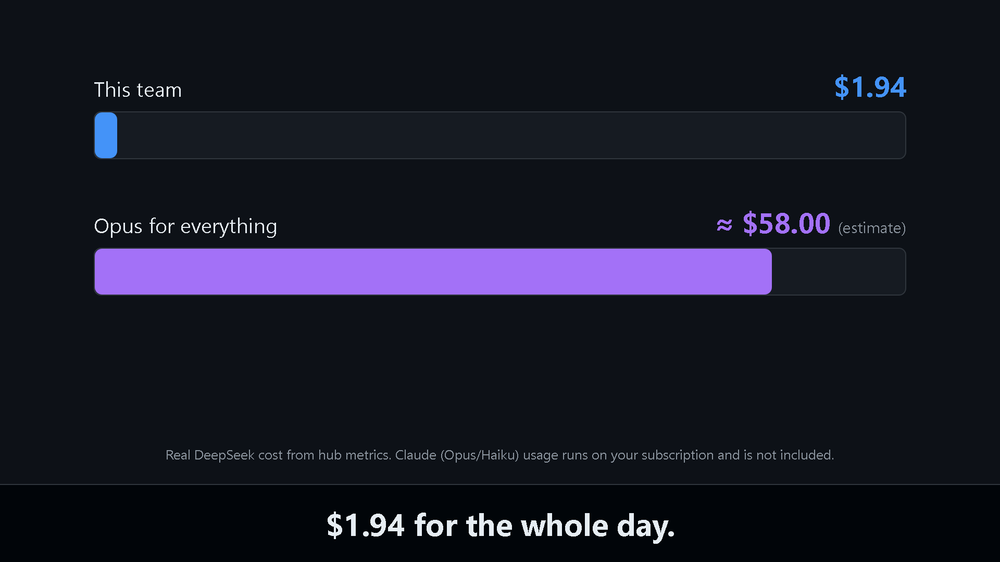

# sistema-cerebro-agentes

Arquitectura de IA para desarrollo **instalable en Windows, macOS y Linux**, pensada para gastar poco y trabajar mucho:

| Capa | Quién | Qué hace | Coste |
|---|---|---|---|
| 🧠 **Cerebro** | Claude Code (tu suscripción) | Opus 5.5 piensa, decide, escribe specs y revisa. Sonnet resuelve áreas acotadas y Haiku hace lo barato (leer, resumir, documentar). | Suscripción de Claude (20 $) |
| 🖥️ **Cerebro Hub** | App local (Docker) | Memoria compartida de todos los proyectos, contexto de sesiones (briefing/checkpoints), vigilante de trabajos, triaje de tareas y panel. | Gratis (Docker local) |
| 🧭 **Laya** | Modelo local de decisiones (Docker) | Decide en milisegundos **qué agente y qué esfuerzo** toca cada tarea, con probabilidades calibradas. | Gratis (CPU) |
| 🤖 **Manos** | OpenCode + **DeepSeek V4.1 Flash** (oficial) | Escribe, depura, prueba y revisa el código siguiendo las specs, por céntimos. | Tokens de DeepSeek |
| 🐌 **Local** | Ollama/Qwen (tu GPU) | Tareas mecánicas explícitas, solo si tú lo pides. | Gratis |

El puente entre capas es **[opencode-mcp](https://github.com/AlaeddineMessari/opencode-mcp)** (stdio local) y el hub. Este repositorio es la **fuente de verdad**: configuración, agentes, app, instaladores y documentación.

## Vídeo: un día de trabajo (75 s)

[](docs/media/demo.es.mp4)

▶️ [Ver en español](docs/media/demo.es.mp4) · [Watch in English](docs/media/demo.mp4) — fuente en [`docs/media/src/video/`](docs/media/src/video/) (Remotion; `npm run render`).

## Cómo funciona

```
 Tú
  │  (hablas en lenguaje natural)
  ▼
┌──────────────────────────── Claude Code (cerebro) ────────────────────────────┐
│  · Opus 5.5: decide, escribe specs, revisa   · Sonnet: resolutor, retocador   │
│  · MCP `opencode` → código en DeepSeek       · Haiku: explorador, redactor,   │
│  · MCP `triaje`   → ¿a quién le toca?        · analista, ayudante, subdirector│
│                                              · Opus 5.5: arquitecto, consultor│
└───────┬───────────────────────────────────────────────────────────────┬───────┘
        │ hooks (briefing/checkpoints)                                  │ MCP
        ▼                                                               ▼
┌────────────────────────── Cerebro Hub (Docker) ──────────────┐  servidor OpenCode V1
│  memoria externa a los repos · vigilante · panel · triaje ──►│  (nativo: trabaja
│      ▲                                                       │   sobre tus carpetas)
│      └── Laya (Docker, decisiones locales)                   │      │
└──────────────────────────────────────────────────────────────┘      ▼
                                                        agentes DeepSeek por esfuerzo:
                                                        implementador · debugger · revisor
                                                        testeador · explorador-ds · redactor-ds
```

**Sin Claude** (cuota agotada) el mismo flujo lo dirige `cerebro-oc` dentro de OpenCode: al abrirlo, ya te atiende el agente "más listo" (DeepSeek · max) y delega él solo en el resto.

## Qué hace por ti sin que te enteres

- **Briefing automático**: al abrir cualquier sesión de Claude en un proyecto con memoria, el hub le inyecta el estado (tarea activa, quién la tiene, siguiente paso, alertas y trabajos en curso). Verificado: Claude responde "¿en qué estamos?" sin que se lo cuentes.
- **Planifica antes de gastar**: en tareas ambiguas, el subagente `planificador` (Haiku) saca las preguntas mínimas que cambian el trabajo (máx. 5) con supuestos por defecto; el Cerebro te las pregunta antes de escribir la spec o delegar código.
- **Ves a las manos trabajar**: el Cerebro te cuenta el progreso de cada job de OpenCode (agente · esfuerzo, estado, tiempo, coste y último paso) sin volcar conversaciones; la barra de estado ([claude-hud](https://github.com/jarrodwatts/claude-hud)) muestra modelo, esfuerzo, git, contexto, uso con reinicio, coste, el modo, el trabajo de OpenCode y las herramientas, subagentes y tareas en curso. Y en el panel, al pinchar en un agente, ves su **razonamiento en directo**, su actividad y sus siguientes pasos.
- **Nada sigue en segundo plano**: al cerrar la sesión de Claude (o hacer `/clear`) se cancelan los trabajos de OpenCode de ese proyecto; y con `cerebro-parar` (o pidiendo «para todo» al Cerebro) los apagas todos de golpe. `cerebro-parar --seco` te enseña antes lo que haría.
- **Todo dentro de Claude**: el mod «mesa de trabajo» dibuja una **banda sobre el prompt** con los trabajos y subagentes en vivo (con su modelo: Haiku visible) y añade **`/trabajos`**, **`/errores`** y **`/parar-todo`**; además fija el modelo de cada subagente según su definición.
- **`/clear` sin miedo**: al ~70 % de contexto, el agente vuelca el estado; al abrir la siguiente sesión, todo está de vuelta. Antes de compactar, un hook guarda un checkpoint solo.
- **Avisos y nota de sesión**: el aviso de contexto (desde 100k tokens y cada +50k) también sale en tu consola, y al cerrar o hacer `/clear` Haiku deja una nota de 5 líneas que se carga sola al volver.
- **Reparto por esfuerzos**: DeepSeek low/high/max según el trabajo (`implementador`/`testeador` low, `debugger` high, `revisor` max solo con código con lógica); en Claude, Haiku para lo ligero, `retocador` Sonnet · low y `resolutor` Sonnet · medium (high al depurar), con `consultor`/`arquitecto` en Opus; el código **no consume tu ventana de Claude**.
- **Triaje local (Laya)**: decide a quién mandar cada tarea; si duda (confianza < 0,60), mandan las reglas; **cada decisión queda registrada** para afinar Laya con tu uso real.
- **Vigilante**: detecta trabajos atascados o permisos colgados y avisa (histórico silencioso al arrancar).
- **Panel local** (solo en `127.0.0.1`): organización en vivo, proyectos y memorias, vigilante, gasto (saldo DeepSeek + sesiones) y **ventana de Claude** estimada (tokens nuevos y caché, 5 h/7 d).

## Requisitos

- **Node.js ≥ 22** — [nodejs.org](https://nodejs.org)
- **OpenCode V2** — [opencode.ai](https://opencode.ai) con el proveedor **DeepSeek** conectado (`opencode auth login` o `/connect`). *(El instalador añade su propio servidor OpenCode V1 aislado en `~/.sistema-cerebro-agentes/server` para el MCP; tu TUI no se toca.)*
- **Claude Code** — [claude.com/claude-code](https://claude.com/claude-code) con tu suscripción.
- **Docker Desktop** — para el hub y Laya (la primera vez, Laya descarga ~850 MB de pesos; quedan en un volumen).
- **Git** — para clonar y actualizar.

## Instalación

### Windows

```powershell
git clone https://github.com/urben88/sistema-cerebro-agentes.git %USERPROFILE%\Desktop\sistema-cerebro-agentes
cd %USERPROFILE%\Desktop\sistema-cerebro-agentes
powershell -ExecutionPolicy Bypass -File .\install.ps1
```

### macOS / Linux

```bash
git clone https://github.com/urben88/sistema-cerebro-agentes.git ~/sistema-cerebro-agentes
cd ~/sistema-cerebro-agentes
bash install.sh
```

El instalador es **idempotente**, hace **copia de seguridad** de todo lo que reemplaza en `~/.sistema-cerebro-agentes/backups/` y no toca nada más de tu configuración. Después: **reinicia Claude Code** y verifica:

```powershell
powershell -ExecutionPolicy Bypass -File .\scripts\verificar.ps1 -Smoke    # Windows
bash scripts/verificar.sh --smoke                                          # macOS/Linux
```

## Uso diario

| Quieres | Haz esto | Qué pasa por detrás |
|---|---|---|
| Trabajar con Claude | Abre Claude Code en tu proyecto y escribe `cerebro` (o `@cerebro …`) | Briefing inyectado; planificación si hace falta; reparto automático Opus → Sonnet → Haiku → OpenCode; revisión y cierre |
| Que investigue sin tocar nada | Pide `plan …` o «propón…»; para ejecutar, di «ejecuta» o «hazlo» | Sin indicación trabaja en **PLAN** (salvo cambios triviales) y pregunta antes de ejecutar |
| Planificar algo grande o ambiguo | Pide `planifica …` o abre el `planificador` (Claude: `@planificador …`; OpenCode: cámbialo con Tab) | Entrevista: hasta 5 preguntas que cambian el trabajo + supuestos + plan/spec antes de generar |
| Parar algo que se quedó corriendo | `cerebro-parar` (o pídele «para todo» al Cerebro) | Cancela los trabajos de OpenCode al momento; `cerebro-parar --seco` solo los lista |
| Verlo dentro de Claude | `/trabajos`, `/errores` o `/parar-todo` en cualquier sesión | El mod «mesa de trabajo» lo muestra en la banda y responde en el transcript |
| Sin Claude (cuota agotada) | Abre OpenCode en tu proyecto | Arranca `cerebro-oc` (DeepSeek · max): specs y delegación en el resto |
| Verlo todo | Abre el panel: `~/.sistema-cerebro-agentes/hub.ps1` (o `hub.sh`) → `http://127.0.0.1:4597` | Organización, memoria, triaje, gasto y ventana |
| Cambiar algo | Editor de bots del panel antiguo (`panel.ps1`) o edita el repo y `scripts/actualizar` | Todo queda versionado en este repositorio |

Reglas de oro para que la ventana de Claude dure: **`/clear` al cambiar de tarea**, nada de fanout de subagentes, el código siempre por DeepSeek, y las specs en archivo. Detalles en [docs/ventanas-y-ahorro.md](docs/ventanas-y-ahorro.md).

## La organización (agentes)

| Familia | Agente | Modelo · esfuerzo | Cuándo |
|---|---|---|---|
| Dirección | `cerebro` (Claude) y sesión principal | Opus 5.5 · medium | Decide dónde profundizar, orquesta, specs, revisión final |
| Dirección intensa | `arquitecto` (Claude) | Opus 5.5 · **high** | Decisiones globales difíciles: arquitectura, migraciones, contratos |
| Segunda opinión | `consultor` (Claude) | Opus 5.5 · **low** | Validar una decisión, elegir entre 2–3 opciones, detectar un riesgo (solo lectura, ≤ 10 líneas) |
| Planificación | `planificador` (Claude) / `planificador` (OC) | Haiku · medium / DeepSeek · high | Preguntas mínimas (máx. 5) antes de generar en tareas ambiguas |
| Exploración | `explorador` (Claude) / `explorador-ds` (OC) | Haiku · **low** / DeepSeek · low | Buscar, resumir, extraer contexto |
| Documentación | `redactor` / `redactor-ds` | Haiku · **low** / DeepSeek · low | README, docs, changelog |
| Verificación | `analista` (Claude) | Haiku · medium | Requisitos vs realidad, checklists |
| Control | `subdirector` (Claude) | Haiku · medium | Bucles y gasto de los trabajos |
| Resolución (Claude) | `resolutor` | Sonnet · **medium** (high al depurar) | Decide el cómo de un área acotada y la resuelve; en el cerebro, solo si OpenCode falla dos veces |
| Retoque (Claude) | `retocador` | Sonnet · **low** | Cambios pequeños en 1–2 archivos con algo de criterio (arreglo obvio, adaptar código, tests desde una spec) |
| Cambio mecánico (Claude) | `ayudante` | Haiku · **low** | Cambios ya decididos con instrucciones exactas (solo en modo EJECUTAR) |
| Implementación | `implementador` (OC) | DeepSeek · **low** | Código delimitado por una spec |
| Depuración | `debugger` (OC) | DeepSeek · high | Fallos reproducibles (máx. 2 ciclos) |
| Revisión técnica | `revisor` (OC) | DeepSeek · max | Diff + edge cases (solo si hay código con lógica que revisar) |
| Pruebas | `testeador` (OC) | DeepSeek · low | Ejecutar/interpretar tests |
| Sin Claude | `cerebro-oc` (OC) | DeepSeek · max | El cerebro de sustitución |
| Mecánico | `local` (OC) | Ollama/Qwen | Solo si tú lo pides |

Los agentes son **perfiles**: se activan bajo demanda y terminan al devolver su resultado. La delegación **se corta** en los subagentes (nada de cadenas).

Además de estos roles por defecto (globales, disponibles en todos los proyectos), **cada proyecto puede añadir agentes propios** en `.claude/agents/` y `.opencode/agents/`: son aditivos y un mismo nombre solo pisa en ese proyecto. Guía: [docs/agentes-por-proyecto.md](docs/agentes-por-proyecto.md).

## Docker (hub + Laya)

```powershell
powershell -NoProfile -ExecutionPolicy Bypass -File ~\.sistema-cerebro-agentes\docker\gestion.ps1 up   # arrancar
powershell -NoProfile -ExecutionPolicy Bypass -File ~\.sistema-cerebro-agentes\docker\gestion.ps1 status
powershell -NoProfile -ExecutionPolicy Bypass -File ~\.sistema-cerebro-agentes\docker\gestion.ps1 down   # parar
```

- `hub` → `127.0.0.1:4597` (backend + panel). Laya vive en la red interna; el puente MCP y el servidor OpenCode siguen en el host (trabajan sobre tus carpetas) y el hub los alcanza por `host.docker.internal`.
- En Windows, el instalador registra el **autoarranque** al iniciar sesión (tarea programada «Cerebro Hub»; si Windows deniega la tarea, cae a la carpeta de Inicio con `cerebro-hub.cmd`).
- La memoria vive en `~/.sistema-cerebro-agentes/hub-data/` (montada en el contenedor): `memoria/global`, `memoria/proyectos/<slug>` (ESTADO, BITACORA, CONTEXTO-REPO, checkpoints) y `memoria/temporal`.

## El Cerebro Hub por dentro

- **API local** (solo `127.0.0.1`): `salud`, `briefing`, `proyectos`, `memoria/*` (estado, contexto, bitácora, checkpoints), `vigilante`, `organizacion`, `gasto`, `ventana`, `reglas`, `triaje`, `decisiones`.
- **Hooks** (`~/.sistema-cerebro-agentes/hooks/`): `session-start`, `pre-compact`, `session-end` y el CLI `estado` (`--leer`, `--escribir --archivo`, `--bitacora`, `--checkpoint`).
- **MCP de triaje** (`config/mcp/triaje-mcp.mjs`): herramienta `triaje_decidir` disponible dentro de `cerebro` y `subdirector`.
- **Reglas** (`config/hub/reglas.json`): reparto, topes de coste por job y paralelismo máximo; editables en la copia de datos.

Guía completa: [docs/contexto-sesiones.md](docs/contexto-sesiones.md) · [docs/ventanas-y-ahorro.md](docs/ventanas-y-ahorro.md).

## Estructura del repositorio

```
sistema-cerebro-agentes/
├── install.ps1 / install.sh          ← instaladores (idempotentes, con backups)
├── uninstall.ps1 / uninstall.sh      ← desinstaladores (conservan memoria y backups)
├── config/
│   ├── claude/                       ← agente cerebro + subagentes, CLAUDE.md, skill de delegación
│   ├── opencode/agents/              ← agentes DeepSeek por esfuerzo (+ local)
│   ├── hub/                          ← Cerebro Hub: backend, panel, plantillas, reglas, Dockerfile
│   ├── hooks/                        ← hooks de contexto y CLI `estado`
│   ├── mcp/                          ← lanzador del MCP y MCP de triaje
│   ├── web/                          ← panel antiguo de actividad (sigue disponible)
│   └── bin/                          ← comando `cerebro`
├── docker/                           ← docker-compose (hub + Laya) y gestor
├── docs/                             ← arquitectura, uso, panel, contexto/sesiones, ahorro, decisiones
└── scripts/                          ← verificar, actualizar, smoke del MCP, panel
```

## Mover a otra máquina

En la máquina de desarrollo: `git add -A && git commit && git push`. En cualquier otra: `git pull` + `scripts/actualizar.ps1`/`actualizar.sh` (pull + reinstalación completa). El versionado vive en `VERSION`, `CHANGELOG.md` y los tags de Git.

## Desinstalación

```powershell
powershell -ExecutionPolicy Bypass -File .\uninstall.ps1    # Windows
bash uninstall.sh                                           # macOS/Linux
```

Quita agentes, hooks (solo los del sistema), hub, contenedores y tarea de autoarranque; **conserva** la memoria (`hub-data`) y los backups en `~/.sistema-cerebro-agentes/backups/`.

## Créditos

- [opencode-mcp](https://github.com/AlaeddineMessari/opencode-mcp) — puente MCP entre Claude y OpenCode.
- [OpenCode](https://opencode.ai) — capa de ejecución.
- [Claude Code](https://claude.com/claude-code) — capa de pensamiento.
- [Laya](https://huggingface.co/convaiinnovations/laya) — modelo local de decisiones (Apache 2.0).
